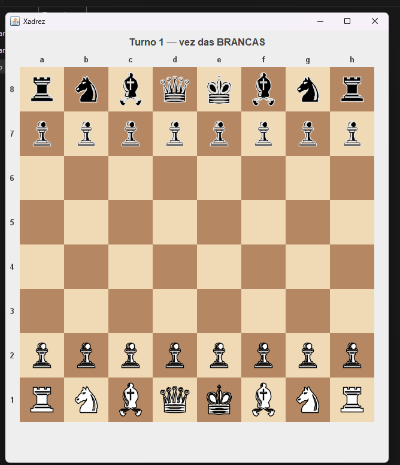

# Xadrez em Java

Jogo de xadrez para dois jogadores, desenvolvido em Java, com versão
em terminal e interface gráfica (Swing).



## Funcionalidades

- Tabuleiro gráfico com clique do mouse
- Destaque das jogadas possíveis
- Regras especiais: roque, en passant e promoção do peão
- Detecção de xeque e xeque-mate
- Lista de peças capturadas
- Versão em terminal (`App.java`)

## Como executar

### Opção 1: baixar o executável (Windows)

Baixe o `.zip` na página de [Releases](https://github.com/SauloArlindo/xadrez_java/releases/tag/V1), extraia e
dê dois cliques em `Xadrez.exe`. Não precisa ter Java instalado.

### Opção 2: pelo código-fonte

Requisito: JDK 17 ou superior.

```bash
git clone https://github.com/SauloArlindo/xadrez_java.git
cd xadrez_java
javac -d out src/*.java src/boardgame/*.java src/chess/*.java src/chess/pieces/*.java
java -cp out ChessGUI
```

Para jogar no terminal, troque `ChessGUI` por `App`.

## Como jogar

1. Clique na peça que deseja mover.
2. As casas possíveis aparecem marcadas em azul.
3. Clique na casa de destino.

As brancas começam. No terminal, informe as posições no formato `e2`, `e4`.

## Estrutura do projeto

```
src/
├── App.java          # versão em terminal
├── ChessGUI.java     # interface gráfica (Swing)
├── UI.java           # impressão do tabuleiro no terminal
├── boardgame/        # tabuleiro, posição e peça (camada genérica)
└── chess/            # regras do xadrez e as peças
```

A lógica fica separada da interface, então a mesma `ChessMatch` serve
para o terminal e para a janela.

## Tecnologias

Java, Swing (`javax.swing` / `java.awt`)

## Autor

Saulo Arlindo — [GitHub](https://github.com/SauloArlindo)